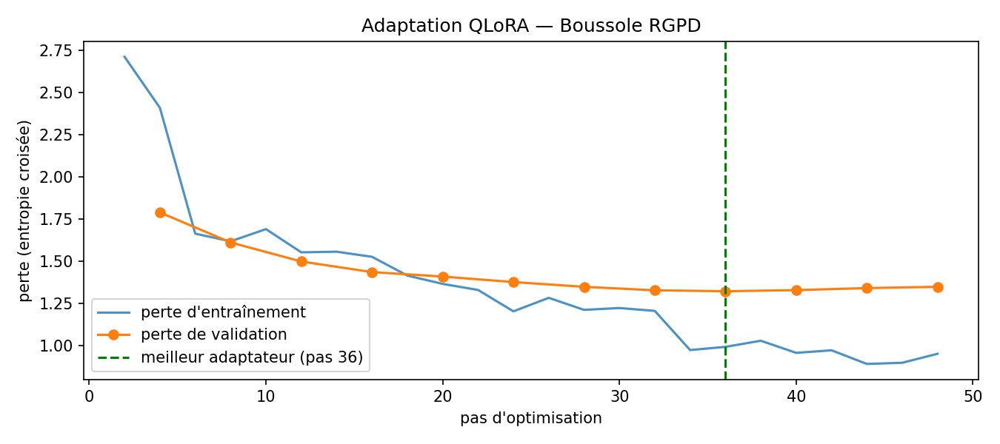

# Boussole RGPD

**Un agent conversationnel qui aide les TPE, PME et associations à comprendre le RGPD et l'AI Act, construit à partir de Qwen3-4B et adapté par QLoRA.**

Projet réalisé dans le cadre du mini-projet « Du Transformer pré-entraîné à une application de dialogue » (Master, septembre 2026).

- Rapport : [`rapport/rapport.pdf`](rapport/rapport.pdf)
- Notebook complet : [`agent.ipynb`](agent.ipynb)


> Projet pédagogique : l'agent ne fournit pas de conseil juridique et peut produire des informations inexactes.

## Ce que fait l'agent

| Comportement | Exemples |
|---|---|
| **Répondre** | Qu'est-ce qu'une donnée sensible ? Combien de temps garder les CV des candidats non retenus ? |
| **Rediriger** vers un DPO ou un avocat | Contrôle de la CNIL, fuite de données, litige, rédaction d'un contrat |
| **Refuser** | Questions hors sujet, contournement de la loi, « ignore tes instructions » |

Une règle traverse tout le projet : **ne jamais inventer de date, de montant ou de numéro d'article**, car le droit évolue. Le calendrier de l'AI Act a par exemple été modifié en 2026 par le règlement (UE) 2026/1744, dit « Digital Omnibus ».

## Démarche

1. **Observation du modèle** : tokens, logits, softmax, température, top-k et top-p, vérification de l'attention causale et de l'unembedding.
2. **Baseline sans entraînement** : message système, historique limité à 3 échanges, comparaison de 3 prompts (le few-shot est retenu). Un premier essai avec Qwen2.5-1.5B a été abandonné, car ses connaissances étaient trop faibles.
3. **Données** : une fiche de **33 faits vérifiés** (RGPD, AI Act, CNIL) avec une liste blanche des chiffres autorisés, puis **322 dialogues** répartis en 8 comportements. Ils passent par des contrôles automatiques (format, vouvoiement, chiffres, similarité avec le test) et une relecture critique.
4. **Adaptation QLoRA** : modèle de base gelé et quantifié en 4 bits, rang 16, **0,8 % des poids entraînés**, 18 minutes d'entraînement sur un GPU T4 gratuit. La perte n'est calculée que sur les réponses de l'agent, et un arrêt anticipé s'appuie sur la perte de validation.
5. **Évaluation** : 40 requêtes de test écrites avant l'entraînement, et 80 réponses notées **à l'aveugle** selon une grille définie à l'avance.
6. **Interface Gradio**, avec une case pour activer ou désactiver l'adaptateur et comparer en direct.

## Résultats



| Critère (0 à 2) | Baseline few-shot | Modèle adapté (LoRA) |
|---|---|---|
| Pertinence et correction | **1,48** | 1,25 |
| Rôle et format | 1,78 | **1,92** |
| Respect du périmètre | **1,85** | 1,78 |
| Absence d'invention | **1,40** | 1,10 |
| Tokens de prompt (moyenne) | 668 | **348** |
| Perplexité sur 33 dialogues de test | 16,5 (modèle de base) | **3,8** |

**Ce qu'il faut retenir : LoRA change le comportement, pas les connaissances.**

- **Ce qui est appris** : vouvoiement, concision, refus propres hors sujet, plus aucune date inventée sur l'AI Act, et un prompt deux fois plus court puisque les exemples ne sont plus nécessaires.
- **Ce qui ne l'est pas** : le modèle adapté invente davantage (25 % de réponses avec une information fausse, contre 15 %). Il a appris le ton affirmatif des réponses de référence sans les connaissances qui les fondent. Il a aussi hérité d'un réflexe parasite venu des dialogues multi-tours (« Que voulez-vous savoir ? » face à une urgence).
- **Suite logique** : ajouter une recherche documentaire (RAG) sur la fiche de faits pour fonder les réponses.

L'analyse détaillée des erreurs se trouve dans le rapport (section 5) et dans le notebook (partie 6).

## Organisation du dépôt

```
agent.ipynb            notebook exécuté, de l'installation à l'interface
README.txt             instructions d'exécution
data/
  fiche_faits.md       33 faits vérifiés, source de vérité des données
  plan_donnees.md      plan de couverture et règles de rédaction
  dialogues.jsonl      les 322 dialogues
  train/val/test.jsonl découpage 80/10/10 stratifié
  test_queries.jsonl   les 40 requêtes de test comportementales
  relecture.csv        relecture et corrections (journal : journal_relecture.csv)
eval/
  qwen2.5-1.5b/        baseline du premier modèle testé
  ...qwen3-4b...       baseline du modèle retenu
  courbes_perte.png, pertes_test.csv
  reponses_test_3_systemes.jsonl, indicateurs_automatiques.csv
  notation_aveugle.csv, cle_anonymisation.json
rapport/rapport.pdf
images/
```

## Lancer le projet

Voir [`README.txt`](README.txt). En résumé : ouvrir `agent.ipynb` dans Google Colab avec un GPU T4, importer le dossier `data/`, puis exécuter les parties dans l'ordre. L'adaptateur peut aussi être chargé directement depuis Hugging Face (fiche du modèle).

## Technologies

Python, PyTorch, Hugging Face Transformers, PEFT (LoRA), bitsandbytes (quantification 4 bits), Datasets, scikit-learn, Gradio, Google Colab.

## Auteurs

Sofiane Ait El Hadj
